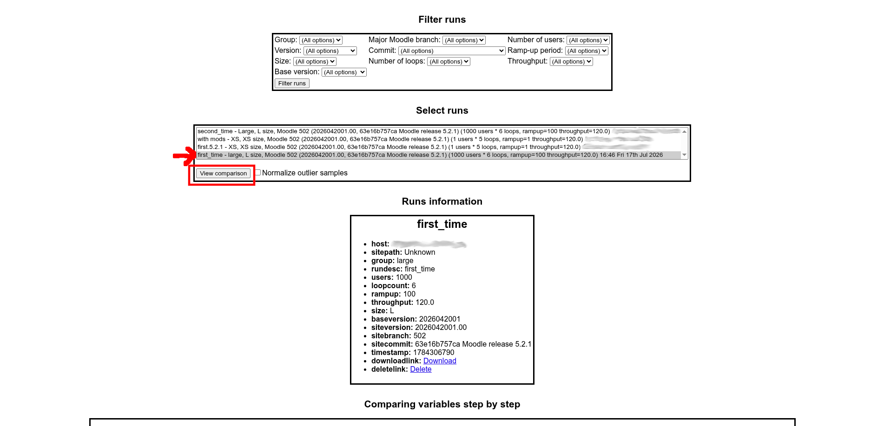
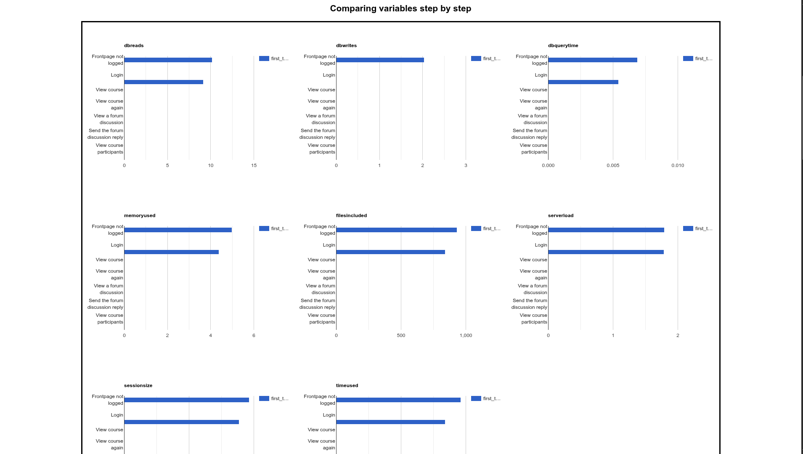
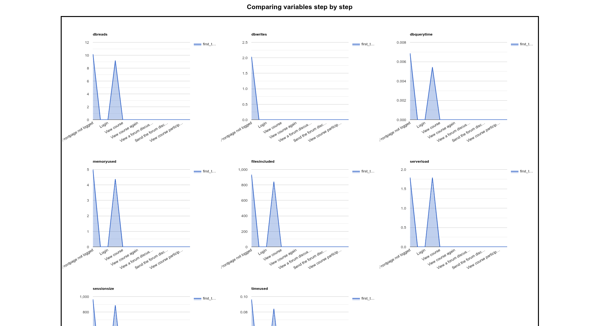
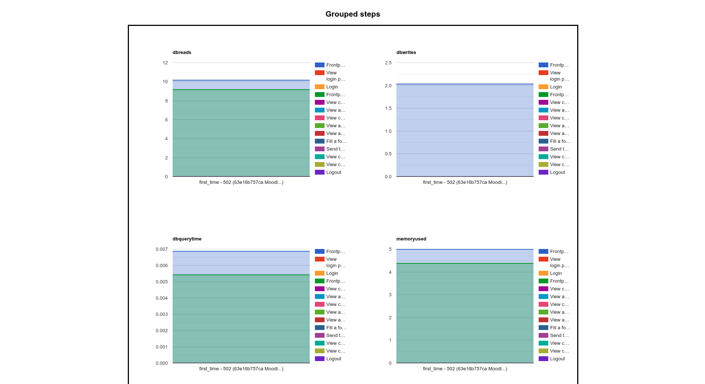

> **Everything was installed on the same machine as Moodle.**

> I'm being `root` user while installing all of this.

---

# `moodle-performance-comparison` tool:

> Github Link: [https://github.com/moodlehq/moodle-performance-comparison](https://github.com/moodlehq/moodle-performance-comparison)

> `moodle-performance-comparison` is an Official tool used to test and compare Moodle performance either you are testing after some tuning or comparing two Moodle versions.

> The tool installs the testing Moodle instance in `moodle-performance-comparison/moodle/` directory, you will need this info when you create the Apache `conf` file for it.

> The testing result page is hosted in `moodle-performance-comparison` itself, you will need this info when you create the Apache `conf` file for it.

**Test Size Table:**

| Size               | symbol  | Concurrent Users |
| ------------------ | ------- | ---------------- |
| Extra Small        | **XS**  | 1                |
| Small              | **S**   | 30               |
| Medium             | **M**   | 100              |
| Large              | **L**   | 1,000            |
| Extra Large        | **XL**  | **5,000**        |
| Extra  Extra Large | **XXL** | 10,000           |

> **IMPORTANT**: It's fine to install this tool on the **same machine hosting Moodle** as long as you are testing with `1000(L)` users or below.

> Any test with number of users > `1000(L)` you should install the tool on a different VM.

---
# Getting Your Testing Environment Ready:

> On the same VM hosting Moodle.
### Download the testing tool:

**Clone in directly in `/var/www/html/moodle-performance-comparison-main`**
```bash
git clone https://github.com/moodlehq/moodle-performance-comparison.git /var/www/html/moodle-performance-comparison-main

# Change ownership:
chown -R www-data:www-data /var/www/html/moodle-performance-comparison-main
```

**Create other needed directories for testing:**
```bash
mkdir -p /srv/moodle-test/test_db_dump /srv/moodle-test/moodledata

# Change ownership:
chown -R www-data:www-data /srv/moodle-test/test_db_dump /srv/moodle-test/moodledata
```

or

> Go to [https://github.com/moodlehq/moodle-performance-comparison](https://github.com/moodlehq/moodle-performance-comparison)

> Click `Code` -> `Download ZIP`.


****
### Install Requirements:

> These are the dependencies that should be installed on the machine.

- MySQL or PostgreSQL: I already have **mariadb** installed.
- Git: `apt install git`.
- cURL: `apt install curl`.
- PHP 8.4: already installed.
- Java 6 or later: the next step shows you how to install `openjdk-21-jdk`.

**Install `openjdk-21-jdk` on Ubuntu `24.04`:**
```bash
apt update
apt install -y openjdk-21-jdk
java -version
javac -version
echo 'export JAVA_HOME=/usr/lib/jvm/java-21-openjdk-amd64' >> ~/.bashrc
echo 'export PATH=$JAVA_HOME/bin:$PATH' >> ~/.bashrc
source ~/.bashrc
echo "$JAVA_HOME"
```

- JMeter - [https://jmeter.apache.org/download_jmeter.cgi](https://jmeter.apache.org/download_jmeter.cgi) binaries (probably you will face problems using apt-get or other package management systems to download it) download the .tgz file under ## Binaries.

**Download and install `apache-jmeter-5.6.3`:**
```bash
apt update && apt install -y wget tar
wget https://dlcdn.apache.org/jmeter/binaries/apache-jmeter-5.6.3.tgz
cp -R apache-jmeter-5.6.3.tgz /opt/apache-jmeter-5.6.3
# open ~/.bashrc and make sure PATH looks something like this:
vim ~/.bashrc
export PATH=$PATH:$JAVA_HOME/bin:/opt/apache-jmeter-5.6.3/bin
source ~/.bashrc
```

---
### Get the database ready:

> If you don't have `mariadb` installed go to `install-and-config-moodle` step and check the `Database Installation` section.

```bash
# Create the test database.
mariadb -e "CREATE DATABASE test_db DEFAULT CHARACTER SET utf8mb4 COLLATE utf8mb4_unicode_ci;"

# Create a user for testing, please replace <PASSWORD>.
mariadb -e "CREATE USER 'moodle_test_user'@'localhost' IDENTIFIED BY '<PASSWORD>';"

# Grant privileges to the new user:
mariadb -e "GRANT SELECT, INSERT, UPDATE, DELETE, CREATE, CREATE TEMPORARY TABLES, DROP, INDEX, ALTER ON test_db.* TO 'moodle_test_user'@'localhost';"

mariadb -e "GRANT LOCK TABLES ON test_db.* TO 'moodle_test_user'@'localhost';"

# Make it take effect:
mariadb -e "FLUSH PRIVILEGES;"
```

> Replace `<PASSWORD>`.

**Make sure the new database user can connect:**
```bash
# Create a user for testing, please replace <PASSWORD>.
mariadb -u moodle_test_user --password=<PASSWORD>  --socket=/run/mysqld/mysqld.sock
```

> Replace `<PASSWORD>`.

---
### Adding Your Credentials:

**Go to the testing tool's directory:**
```bash
cd  /var/www/html/moodle-performance-comparison-main
```

**Create your own testing credentials file:**
```bash
cp webserver_config.properties.dist webserver_config.properties
```

**Edit the credentials:**
```bash
vim webserver_config.properties
```

> Modify and add your credentials.

**Should look something like the following:**
```bash
dbtype="mariadb"
dbhost="localhost"
dbname="test_db"
# The user should have permissions to create and drop databases.
dbuser="moodle_test_user"
dbpass="<PASSWORD>"
dbprefix="mdl_"
# As explained in README.md these tools are intended to be used in internal networks.
# wwwroot is a domain that you should create for the testing moodle instance.
wwwroot="https://testing-moodle.mans.edu.eg"
# new moodledata for testing
dataroot="/srv/moodle-test/moodledata"
toolgeneratorpassword="moodlerules"

# This is Moodle 5.2.1
basecommit="63e16b757ca8fee05b672a27c23ee27cc8f9fabb"

backupsdir="/srv/moodle-test/test_db_dump"
```

##### Getting `basecommit` for `webserver_config.properties`:

- Go to `https://github.com/moodle/moodle/tags`


- Select the tag of your moodle version:`https://github.com/moodle/moodle/releases/tag/v5.2.1`


**Copy the `basecommit` in the url:**
```
https://github.com/moodle/moodle/commit/63e16b757ca8fee05b672a27c23ee27cc8f9fabb
```

**In this case `basecommit` is :**
```bash
63e16b757ca8fee05b672a27c23ee27cc8f9fabb
```

---
---
### Getting the result and test moodle web-pages ready: 

##### Setup the domain resolving:

> If you are not going to create a domain in your dns server then add the new domains(**EXP:** `testing-moodle.mans.edu.eg.conf`, `testing-moodle-result.mans.edu.eg.conf` ) in your known hosts so that you can access it.

**If you are using linux:**
```bash
vim /etc/hosts
```

**If you are using windows:**
```bash
C:\Windows\System32\drivers\etc\hosts
```

**On top add something like the following:**
```bash
# <IP>          <Domian> 
192.168.1.120	testing-moodle.mans.edu.eg
192.168.1.120	testing-moodle-result.mans.edu.eg
```

---
##### Prepare the websites one the machine being tested:

> I'm assuming that you have ssl certificate, otherwise remove the certificate parts, check out the http(non-secure) part in `install-and-config-moodle` step under the `Apache` section.

#### Test Moodle Page:

**Create a page for the testing Moodle:**
```bash
vim /etc/apache2/sites-available/testing-moodle.mans.edu.eg.conf
```

> Change `ServerName`, `Redirect`, `ServerAlias`, `DocumentRoot`, `Directory` and SSLCertificates according to your setup.

**Should look something like the following:**
```bash

<VirtualHost *:80>
    # Domain name without http://
    ServerName testing-moodle.mans.edu.eg
    Redirect / https://testing-moodle.mans.edu.eg
</VirtualHost>

<VirtualHost *:443>
    # Domain name without http://
    # EXP: Domain Name: mans.edu.eg or IP: 192.168.1.120
    ServerName testing-moodle.mans.edu.eg
    ServerAlias www.testing-moodle.mans.edu.eg

    DocumentRoot /var/www/html/moodle-performance-comparison-main/moodle/public
    
    <Directory /var/www/html/moodle-performance-comparison-main>
        Options FollowSymLinks
        AllowOverride None
        Require all granted
        DirectoryIndex index.php index.html

        # Enable fallback routing for URLs not matching files/directories
        FallbackResource /r.php
    </Directory>

    # PHP-FPM 8.4 FastCGI handler via socket
    <FilesMatch "\.php$">
        SetHandler "proxy:unix:/run/php/php8.4-fpm.sock|fcgi://localhost/"
    </FilesMatch>

    # Log files
    ErrorLog /var/log/apache2/error.log
    CustomLog /var/log/apache2/access.log combined
    
    # all relevant timeouts 
    Timeout 600
    ProxyTimeout 600

    # FastCGI/PHP-FPM: 
    FcgidIOTimeout 600
    FcgidConnectTimeout 600
    FcgidBusyTimeout 600

    SSLCertificateKeyFile /etc/ssl/private/e-learning.mans.edu.eg.private.key
    SSLCertificateFile /etc/ssl/certs/e-learning.mans.edu.eg.public.crt
</VirtualHost>

```

---

#### Result Page:

**Create a page for the results:**
```bash
vim /etc/apache2/sites-available/testing-moodle-result.mans.edu.eg.conf
```

> Change `ServerName`, `Redirect`, `ServerAlias`, `DocumentRoot`, `Directory` and SSLCertificates according to your setup.

**Should look something like the following:**
```bash

<VirtualHost *:80>
    # Domain name without http://
    ServerName testing-moodle-result.mans.edu.eg
    Redirect / https://testing-moodle-result.mans.edu.eg
</VirtualHost>

<VirtualHost *:443>
    # Domain name without http://
    # EXP: Domain Name: mans.edu.eg or IP: 192.168.1.120
    ServerName testing-moodle-result.mans.edu.eg
    ServerAlias www.testing-moodle-result.mans.edu.eg

    DocumentRoot /var/www/html/moodle-performance-comparison-main
    
    <Directory /var/www/html/moodle-performance-comparison-main>
        Options FollowSymLinks
        AllowOverride None
        Require all granted
        DirectoryIndex index.php index.html

        # Enable fallback routing for URLs not matching files/directories
        FallbackResource /r.php
    </Directory>

    # PHP-FPM 8.4 FastCGI handler via socket
    <FilesMatch "\.php$">
        SetHandler "proxy:unix:/run/php/php8.4-fpm.sock|fcgi://localhost/"
    </FilesMatch>

    # Log files
    ErrorLog /var/log/apache2/error.log
    CustomLog /var/log/apache2/access.log combined
    
    # all relevant timeouts 
    Timeout 600
    ProxyTimeout 600

    # FastCGI/PHP-FPM: 
    FcgidIOTimeout 600
    FcgidConnectTimeout 600
    FcgidBusyTimeout 600

    SSLCertificateKeyFile /etc/ssl/private/e-learning.mans.edu.eg.private.key
    SSLCertificateFile /etc/ssl/certs/e-learning.mans.edu.eg.public.crt
</VirtualHost>

```

**Enable your new sites:**
```bash
# Enable:
a2ensite testing-moodle.mans.edu.eg.conf
a2ensite testing-moodle-result.mans.edu.eg.conf

# Restart Apache to apply all changes
systemctl restart apache2
```

> Change `testing-moodle.mans.edu.eg.conf`, `testing-moodle-result.mans.edu.eg.conf` according to your setup.

#### Screenshots from the test result page after running tests:

> **Note**: You can select one or more view(s) and compare them when you click `View comparison`.

> Most important values are `dbquerytime`, `serverload`.

> `dbquerytime`: **Optimal** (< 0.1s – 0.2s per page), **Acceptable** (0.2s – 0.5s per page).

> `serverload`: (< number of cpu cores) is good.







