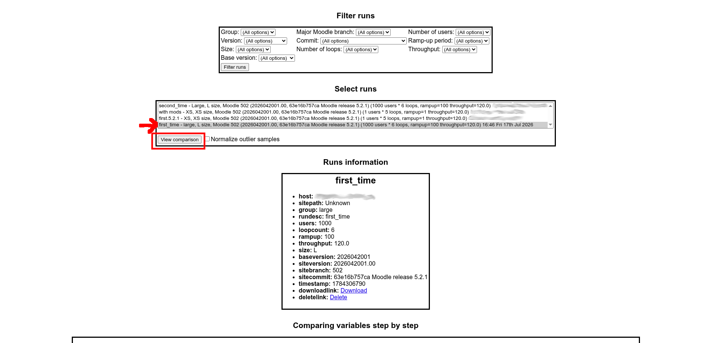
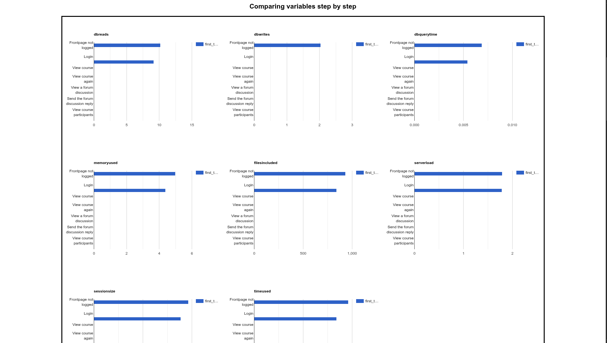
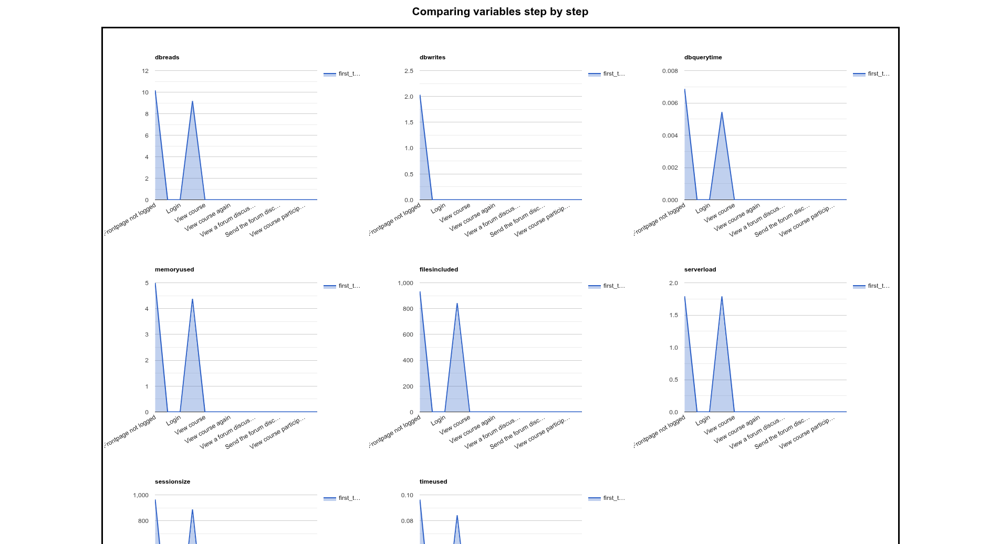
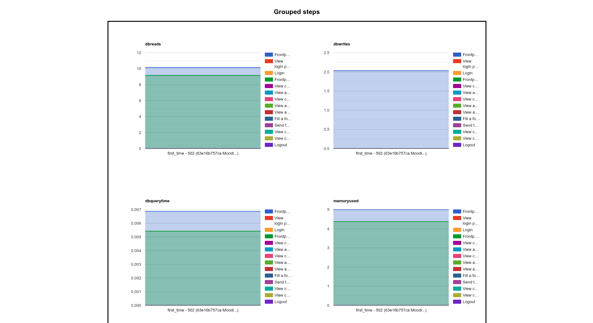

# Testing:

#### Phase One: Load the dummy data for the first time and test.

**Load the database and moodledata with test dummy data:**
```bash
./before_run_setup.sh {XS|S|M|L|XL|XXL}
```

**EXP:** Extra Small.
```bash
./before_run_setup.sh XS
```

---

**Reload configs in case it was changed:**
```bash
./restart_services.sh
```

---

**Run the test:**
```bash
 ./test_runner.sh {groupname} {descriptioname}
```

**Common Error:** Java needs more memory limit.
```bash
Exception: java.lang.OutOfMemoryError thrown from the UncaughtExceptionHandler in thread "Moodle Test 2-65"
```

**Solution:** Add `JVM_ARGS="-Xms1g -Xmx30g"`.
```bash
JVM_ARGS="-Xms1g -Xmx30g" ./test_runner.sh extra_small first_time
```

> `-Xms1g`: Lower limit is `1GB`.

> `-Xmx30g`: Higher limit is `30GB`, lower it to match your available memory.

> Most Important parameters are Server load < CPU Cores, and database access time.

**Results are found in:**
```bash
ls /var/www/html/moodle-performance-comparison-main/runs/*.php
```

> **Common Error:** Sometimes run-files have more than one `<?php` all over the file and it should be only at the beginning -> solution is to remove them all then manually add `<?php` to the beginning of the file.

**Solution:** Delete `<?php` in the output file in `vim`.
```bash
:%s/<?php//g
```

**Should look something like this:**
```php
<?php
$host = 'testing-moodle.mans.edu.eg';
$sitepath = '';
$group = 'large';
$rundesc = 'first_time';
$users = '1000';
$loopcount = '6';
...
...
```

**Runs' output logs can be found here:**
```bash
ls /var/www/html/moodle-performance-comparison-main/runs_outputs/
```

#### Phase Two: Reload the database and moodledata with new test data size:

**Remove the dummy data to reload new ones with different size:**
```bash
./after_run_setup.sh
```

Then repeat `Phase One`.

#### Phase Three: Take a look at the result page created in `Phase One`:

> **Note**: You can select one or more views and compare them by when you click `View comparison`.

> Most important values are `dbquerytime`, `serverload`.

> `dbquerytime`: **Optimal** (< 0.1s – 0.2s per page), **Acceptable** (0.2s – 0.5s per page).

> `serverload`: (< number of cpu cores).

#### Screen shoots from the test result page after running tests:







