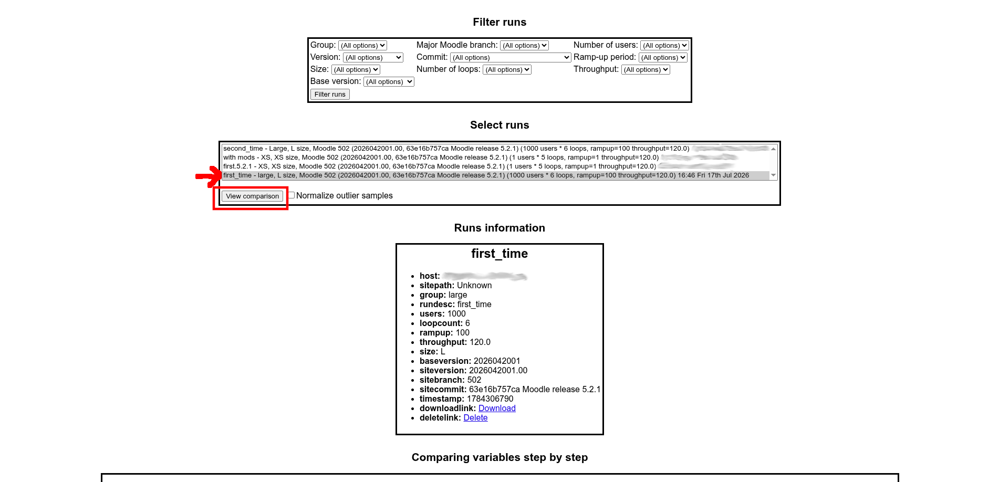
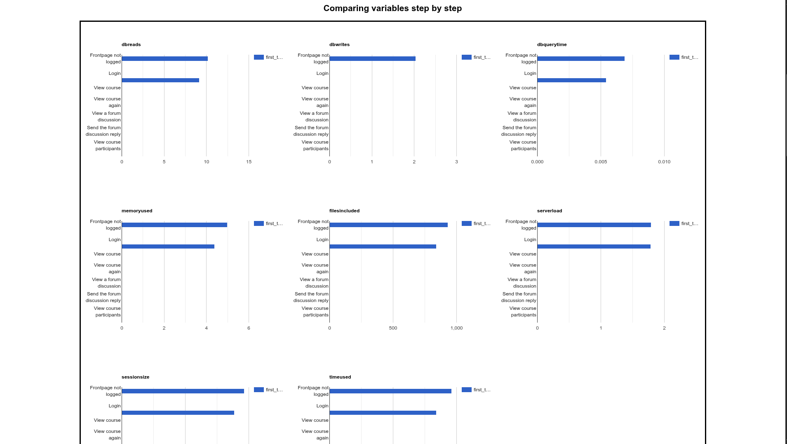

# Intro:

> `moodle-performance-comparison` is an Official tool used to test and compare Moodle performance either you are testing after some tuning or comparing two Moodle versions.

> **Github Link**: [https://github.com/moodlehq/moodle-performance-comparison](https://github.com/moodlehq/moodle-performance-comparison)

> The tool installs the testing Moodle instance in `moodle-performance-comparison/moodle/` directory.

> You will be creating extra two sites configuration files, one for the result and one for the test Moodle found in `1-getting-the-environment-ready`.





---
# Another fast way for testing your server:

> During the testing of 10,000 concurrent connections the webserver used extra 25GB of ram and 95% of CPU Usage on an old intel-xeon cpu that is equivalent to `Intel Core i7-7700` after tuning the system and apps to handle them.
#### Testing 10,000 concurrent connections from a different machine:

> Make sure you have Apache benchmark installed on the device you are testing from either Window(`ab.exe`) or Linux: 

**On windows powershell:**
```powershell
choco install apache-httpd
```

**On Ubuntu and Linux Mint**
```bash
sudo apt update 
sudo apt install apache2-utils -y
```

> The bandwidth I needed to achieve that test was about `70mbps` network speed.

**Make sure `ulimit` in the terminal is enough for `10240` open sockets:**
```bash
ulimit -n 10240
```

**Use apache benchmark to test concurrent requests per second:**
```bash
ab -n 10000 -c 1000 https://e-learning.mans.edu.eg/
```

> `-n`: Keep increasing number of concurrent requests till you reach that number.

> `-c`: Number of concurrent requests per second.

